<p align="center">
  <picture>
    <source media="(prefers-color-scheme: light)" srcset="assets/identity/wordmarks/planarian-horizontal-light.svg">
    
  </picture>
</p>

# Planarian

A self-healing layer for NixOS. It keeps three things separate: what your
system is meant to be (from your configuration), what it observes, and whether
what it observes is healthy. When they diverge it opens an incident and repairs
it, deterministically, through one executor that runs every change as a
journaled, revertible transaction. If Planarian itself is killed mid-change, a
separate watchdog finishes or reverts the change.

- Specification: [`docs/SPEC.md`](docs/SPEC.md) (v4.3)
- What differs from the spec, and why: [`docs/deviations.md`](docs/deviations.md)
- Fault catalog: [`crates/gym/catalog/phase-a.toml`](crates/gym/catalog/phase-a.toml)

**Status: Phase A, ready for initial user testing on NixOS 26.05.** No language
model is involved. `policy::decide`, the journal state machine and the
ledger are verified with Verus (`docs/verification.md`). What is left is
in `docs/AGENTS.md`.

## Trying it in a VM (one command)

On any Linux machine with Nix (flakes enabled):

```sh
nix run github:aubrika/planarian#vm        # COSMIC desktop with the console, in a window
nix run github:aubrika/planarian#vm-text   # no desktop: a shell in your terminal
```

While the repository is private, Nix needs GitHub credentials of its own
(it does not use a `gh` or browser login). Any one of these works:

```sh
# borrow the GitHub CLI's token for one command
NIX_CONFIG="access-tokens = github.com=$(gh auth token)" nix run github:aubrika/planarian#vm
# or use your SSH key, as git push does
nix run 'git+ssh://git@github.com/aubrika/planarian#vm'
# or from a clone
nix run .#vm
```

To make the first permanent, put `access-tokens = github.com=<token>` in
`~/.config/nix/nix.conf`. The first run builds Planarian and downloads NixOS
from cache.nixos.org; later runs start in seconds.

The VM logs in as `demo` (password `planarian`; `sudo` needs none) and
prints what to try: `planarian status`, `ask "make text bigger"`, and
`demo-fault kill-web` / `corrupt-state` / `crash-loop` to break the fixture
services and watch Planarian respond. Its `/etc/nixos` is a flake that
evaluates to exactly the system you booted, so changes Planarian makes inside
are real rebuilds (they download from cache.nixos.org, so the VM needs the
host's network).

- It uses KVM when `/dev/kvm` is available and falls back to emulation
  (slow, especially the desktop) when not. It takes 6 GB of RAM (3 GB for
  `vm-text`), since Planarian evaluates the whole system inside the VM when
  it makes a change.
- State lives in `planarian-vm.qcow2` in the directory you ran it from.
  Delete it to start over. Delete it too after updating Planarian, since the
  old disk's `/etc/nixos` still points at the old version.
- Generations built inside survive a restart of the VM, but the VM has no
  boot loader: it always boots the system it was launched with, not the
  newest generation Planarian published.
- The text variant's terminal is the serial console: `Ctrl-a x` quits QEMU.

## Trying it from a USB stick

```sh
nix build github:aubrika/planarian#iso      # same credentials as above while the repo is private
sudo dd if=result/iso/planarian-live.iso of=/dev/sdX bs=4M status=progress conv=fsync
```

(`/dev/sdX` is the flash drive: check with `lsblk` first; `dd` overwrites
it. Any image writer works, e.g. GNOME Disks or Fedora Media Writer.) Boot
from it (UEFI or BIOS) and you get the same demo as the VM: COSMIC, the
console, the welcome terminal, `demo-fault`. It runs entirely in RAM, so
changes Planarian makes are real rebuilds (with a network), and everything
is gone at the next boot. Give it at least 8 GB of RAM if you want to try
configuration changes. It does not install anything; to keep Planarian,
install NixOS and follow the next section.

It boots quietly behind the planarian splash. Press Esc during boot to see
the messages, or pick **verbose boot** in the boot menu.

## Trying it on your machine

Planarian needs a flake-based NixOS configuration. It never edits your own
files. It changes only `planarian/overrides.nix`, which your flake imports.

1. Add the input and modules to your flake (or start from the template:
   `nix flake init -t github:aubrika/planarian`):

   ```nix
   inputs.planarian.url = "github:aubrika/planarian";
   inputs.planarian.inputs.nixpkgs.follows = "nixpkgs";
   # in nixosSystem { modules = [ … ]; }:
   ./planarian/overrides.nix
   planarian.nixosModules.default
   planarian.nixosModules.reference   # optional: COSMIC, PipeWire, NetworkManager, a quiet boot
                                      # behind the planarian splash (planarian.reference.verboseBoot
                                      # = true for text), catalog wiring
   { services.planarian.enable = true; services.planarian.owner = "/etc/nixos"; }
   # and make yourself an administrator (approve, restart system services, resolve):
   { users.users.<you>.extraGroups = [ "planarian-admin" ]; }
   ```

2. Copy `nix/template/planarian/overrides.nix` into your configuration as
   `planarian/overrides.nix`, exactly as it is, and `git add` it (flakes only
   see tracked files).
3. `nixos-rebuild switch --flake /etc/nixos#<hostname>`. The attribute must
   match `networking.hostName`, or set `services.planarian.flakeAttr`.
4. `planarian status`.

For the first 10 minutes Planarian says "no baseline yet" and only takes
Runtime actions (restarts, stops). When the canonical health checks pass at
that checkpoint, the generation becomes the known-good baseline.

## What to try

| Try | What should happen |
| --- | --- |
| `sudo systemctl kill -s KILL sshd` | Within about 15 s: an incident, a restart, and `planarian log` shows it. |
| `ask "stop <service> until I say"` | It stops and stays stopped; Planarian won't "repair" it. `ask "start <service> again"` undoes it. |
| `planarian stop <service>` | The same, until the next boot. |
| `ask "make text bigger"` (with the reference module) | A configuration change: built, activated, health-checked, then committed. `planarian log` shows each step. |
| `planarian apply listen-address service=… addr=…` with an address that can't work | Built, activated, checks fail, reverted automatically. |
| `planarian apply service-enable service=sshd enabled=false` | Security-sensitive, so it asks: `sudo planarian approve <hash>`, at a terminal. |
| As a normal user: `planarian suppress sshd` | Refused: `Unauthorized`. |

The console (`services.planarian.console.enable = true;`, on with the
reference module) shows the dependency graph with what is desired,
observed and healthy for each unit, the transaction timeline, the
generations and the incidents. It starts minimized unless something needs
attention. It is dark, like the rest of the identity (`assets/identity`).
While Planarian builds or applies a change, the mark in its window moves
(the kit's "working" motion); set `PLANARIAN_REDUCED_MOTION=1` to keep it still.

The status indicator (`services.planarian.tray.enable`, on with the console)
puts the planarian mark in the panel: no dot when all is well, blue-grey
while a change is being built or applied, amber when something needs a look
(an incident being repaired, an approval, a reverted change), red when
something needs a person (a repair that keeps failing, the recovery
interlock, or the daemon is unreachable). Its tooltip says what; clicking it
opens the console.

Other commands: `planarian incidents`, `planarian log -n 50`, `planarian undo`,
`planarian gc`, `planarian diagnose <unit>`, `planarian cancel <txn>`,
`planarian mark-good`, `planarian resolve <txn> --as-committed|--as-reverted|--manual-repaired`.

### Watching your own services

```nix
services.planarian.units.my-app.probes = [
  { id = "my-app-http"; type = "http"; url = "http://127.0.0.1:8080/health"; establishes = "my-app answers its health check"; }
];
```

Dependencies come from the systemd units themselves: `Requires=`, `BindsTo=`
and `Requisite=` become typed `Requires` edges, and `Wants=` and `After=`
become `Wants` and ordering edges that are never blamed for a failure. Add
`edges`, `sensitivity`, `restartDisruption` and `synonyms` as needed; see
`nix/module.nix`.

Services get a startup grace: a health check that fails in a unit's first
90 seconds after it comes up is not yet a fault (crashes are). Set
`services.planarian.startupGrace`, or `units.<name>.startupGrace` per unit,
for slow machines or slow-starting services.

### If something goes wrong

- `planarian status` shows incidents, pending approvals, any recovery failure
  (which stops autonomous repair until `planarian resolve`), and what the
  daemon found after its last restart.
- Turn it off with `services.planarian.enable = false;` and rebuild. To keep it
  watching without acting, set `services.planarian.maxTier = "Observe";`, and
  everything asks first.
- The daemon logs to the journal: `journalctl -u planariad -u planarian-recovery`.
  The executor log is `/var/lib/planarian/log/executor.jsonl`.

## Development

```
cargo test                                   # every crate
cargo run -p planarian-gym -- run            # the fault catalog, fake harness
crates/gym/demo.sh --harness fake            # the GA demonstration
cargo run -p planarian-gym -- serve --socket /tmp/p.sock   # a fake machine on a socket:
PLANARIAN_SOCKET=/tmp/p.sock cargo run -p planarian-console # try the console (or the CLI) against it
nix build .#checks.x86_64-linux.package      # package + tests in the Nix sandbox
nix build .#checks.x86_64-linux.module-eval  # a full NixOS system evaluated with the module
nix build .#checks.x86_64-linux.vm-runtime   # NixOS VM test on real systemd (KVM recommended)
nix build .#checks.x86_64-linux.verus        # the Verus proofs (docs/verification.md)
```

License: [MPL-2.0](LICENSE).
