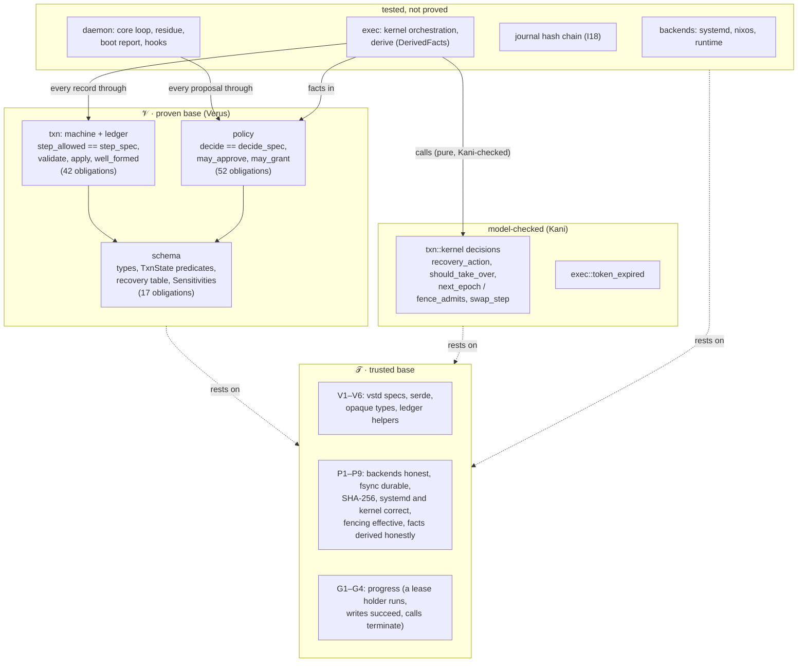
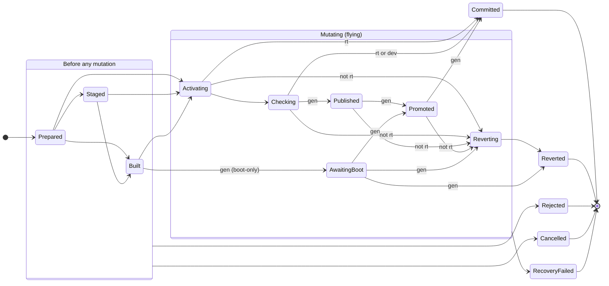
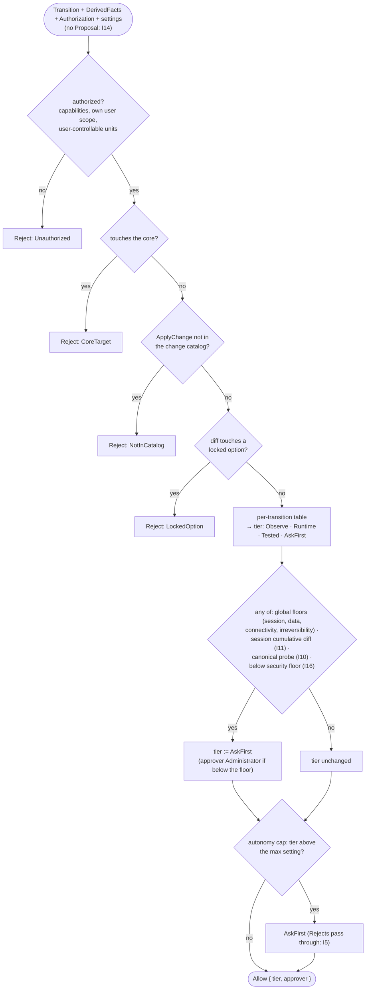
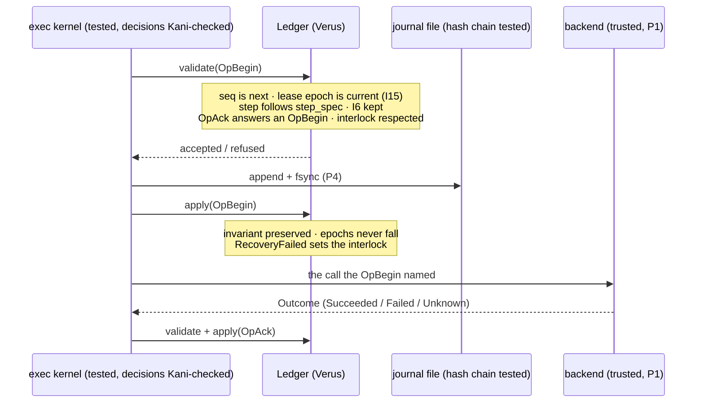

# What Planarian guarantees, and how we know

A map of Planarian's core from four angles: the trust boundary, the
transaction state machine, the policy decision, and the ledger. It lists
every guarantee, what establishes it (a Verus proof, a Kani harness, or
tests only), and what it rests on. Status as of 2026-10-29 (GA baseline).
The detailed proof notes are in `verification.md`; the trusted
assumptions in `assumptions.md`; the counts in `verification-ratio.toml`.

## 0. Names

| Name | Meaning |
| --- | --- |
| **𝒱, the proven base** | The code that is verified: `schema`, `policy`, `txn`, and later crates as they enter the Verus subset. |
| **𝒯, the trusted base** | What 𝒱 relies on but nobody has proved: backends, Nix, systemd, the kernel, firmware, vstd's specifications. Every trust is a line in `assumptions.md`. |
| **d:a** | The verification ratio: proof obligations **d**ischarged to obligations **a**ssumed, per invariant and summed. |
| **trust count, \|𝒯\|** | The number of `assumptions.md` entries plus every `external_body` and `assume` site in the verified crates. |

Today: **d:a = 28:43, trust count = 32.** The ratio counts proof
obligations, not the sets themselves, so it has its own name. In plain
text, write V-base and T-base. (Until 2026-10-29 these were 0v, 0t,
"0v:0t" and "the size of 0t"; the new names replace them everywhere,
because "0v:0t" reads as zero times v.)

## 1. The trust boundary

Verus runs on every CI run; Kani runs by hand (it is not in nixpkgs);
every item of 𝒯 is a line in `assumptions.md`.

Read the arrows as "everything that changes the machine passes through a
proven gate": every journal record goes through `Ledger::validate` and
`Ledger::apply`, every transition through `decide`, and every state step
through `step_allowed`. What is not proved is the code *between* the gates:
whether the executor asks the gates honestly (P9, I14's other half) and
whether the backends do what they report (P1).

## 2. The invariants (SPEC §8)

**Status:** **Proved** = discharged by Verus or Kani under the listed
assumptions. **Tested** = tests and gym entries only (its proof phase in
brackets). d:a counts per invariant, so a lemma that serves two
invariants counts for both (28 counts, 26 distinct obligations).

| Id | Guarantee, in plain words | Status | Discharged by | Rests on | d:a |
| --- | --- | --- | --- | --- | --- |
| I1 | A boot-confirmed known-good generation always exists and is in the boot menu. | Tested [D] | — | P3, P8 | 0:2 |
| I2 | The installed core package is the one that was signed. | Tested [E] | — | P5, P8 | 0:2 |
| I3 | Garbage collection never removes known-good, previous, current, an in-flight candidate or the boot model. | Tested [D] | — | P1, P8 | 0:2 |
| I4 | "Running" means desired Running, observed active, and every readiness probe passed on fresh evidence. | Tested | — | P6 | 0:1 |
| **I5** | **Forbidden actions are unrepresentable; no setting turns a Reject into anything else.** | **Proved** | `decide`, `i5_autonomy_never_touches_reject`, `unauthorized_is_refused_first`, `core_is_never_a_target` | V1, V2, V3 | 4:3 |
| **I6** | **At most one generation-changing transaction is active; nothing else runs during Activating, Published, Promoted or Reverting.** | **Proved** | `validate`, `apply`, `well_formed`, `i6_one_generation_active`, `compatible_exec` | V3–V6, P4 | 5:5 |
| I7 | Every executed transition is logged with its proposal, facts, decision and outcome. | Tested | — | P4 | 0:1 |
| **I8** | **An AskFirst transition runs only with an approval token bound to that exact candidate, re-checked before it runs.** | **Partly proved** (expiry) | `approval_tokens_expire_after_their_lifetime` (Kani) | P5 | 1:1 |
| I9 | The model process can only submit proposals. | Phase E (no model yet) | — | — | — |
| **I10** | **A change that alters a canonical probe never runs below AskFirst.** | **Proved** (decide half) | `i10_canonical_probe_changes_ask` | V1, P9 | 1:2 |
| **I11** | **A session's combined effect is judged at least as strictly as any single step of it.** | **Proved** | `i11_non_routine_session_asks`, `i11_session_only_raises` | V1, V2 | 2:2 |
| **I12** | **Every transaction reaches a terminal state; RecoveryFailed alerts and sets the interlock.** | **Proved, conditional** on G1–G4 | `i12_steps_terminate`, `i12_terminal_always_reachable`, `terminal_is_final`, `refusal_only_before_mutation`, `apply`, `recovery_table_follows_the_state_machine` (Kani), `watchdog_takes_over_only_when_it_should` (Kani) | G1–G4, P1, P4, P7, V5 | 7:8 |
| I13 | A unit under an override is never a repair target while the override holds. | Tested | — | P6 | 0:1 |
| **I14** | **Policy facts come from the evaluated generation, never from the proposal.** | **Proved** (decide half) | `i14_facts_caller_is_not_authority`; `decide` takes no `Proposal` at all | P9, V3 | 1:2 |
| **I15** | **One owner per transaction; a stale epoch is refused; only the lease holder advances the journal.** | **Proved** | `validate`, `takeover_fences_out_the_previous_owner` (Kani) | P4, P7 | 2:2 |
| **I16** | **No automatic revert, rollback or boot fallback goes below the security floor; going below needs an administrator.** | **Proved** (decide; bootloader by test) | `i16_below_floor_needs_administrator`, `administrator_class_only_on_ask_first` | V1, V2, P3 | 2:3 |
| I17 | There is always at least one administrator. | Tested | (`i17_root_is_always_an_administrator` is a unit test) | P8 | 0:1 |
| I18 | Every journal record commits to its predecessor's hash; a broken chain is detected on read. | Tested | — | P5, P4 | 0:2 |
| **I19** | **No principal approves its own proposal or grants itself a capability it lacks.** | **Proved** | `i19_no_self_approval`, `may_approve`, `may_grant` | V1 | 3:1 |
| I20 | No agent starts while planarian-ready.target is not reached, in every failure posture. | Tested | — | P6, P8 | 0:2 |

## 3. Every formal obligation

Every Verus lemma, verified function and Kani harness, with what it means
in practice. **Counts toward** is the invariant row in the ratio file; a
dash means the obligation is proved and runs in CI but no invariant
claims it yet (see §7).

### policy: the decision (Verus)

| Obligation | What it guarantees | Counts toward |
| --- | --- | --- |
| `decide` (verified fn) | The code that runs equals the specification `decide_spec`, for every input. | I5 |
| `i5_autonomy_never_touches_reject` | The autonomy setting never turns a Reject into a tier or back, never changes a reason or the approver class, and raising it never makes a decision stricter. | I5 |
| `unauthorized_is_refused_first` | An unauthorized caller gets `Reject(Unauthorized)`, whatever else holds. | I5 |
| `core_is_never_a_target` | Anything touching Planarian's own core is rejected. | I5 |
| `i10_canonical_probe_changes_ask` | Tampering with a canonical probe's definition is AskFirst or Reject. | I10 |
| `i11_non_routine_session_asks` | A non-Routine diff, this change's or the session's cumulative one, means AskFirst or Reject. | I11 |
| `i11_session_only_raises` | A change inside a session is decided at least as strictly as on its own. | I11 |
| `i14_facts_caller_is_not_authority` | The `caller` field in the facts has no effect on the decision. | I14 |
| `i16_below_floor_needs_administrator` | A target below the security floor is AskFirst with an Administrator approver, or refused, for every transition, caller and setting. | I16 |
| `administrator_class_only_on_ask_first` | An Administrator approver class only ever comes with AskFirst. | I16 |
| `i19_no_self_approval` | No self-approval; approving needs `Approve` (and `Administrator` for that class); no self-grant, nothing granted on one's own proposal, only capabilities the approver holds. | I19 |
| `may_approve`, `may_grant` (verified fns) | The code that runs equals its specification. | I19 |
| `global_floors` | Irreversible changes, session or data loss (unless it is the caller's own session), connectivity loss without a seat, or loss reaching another user's session (unless an administrator): AskFirst or Reject, for every transition kind. | — |
| `own_session_is_per_session` | "Your own session" means exactly that session: another session of the same user, or an unknown one, asks. | — |
| `security_override_held_for_administrator` | A non-administrator's override of a Security-sensitive unit never runs on its own. | — |
| `security_restart_runs_alone_only_to_restore` | A Security-sensitive unit's restart runs without asking only to restore an unattributed stop, and never for an External one (G16). | — |
| `agents_and_unattributed_are_refused` | Agents and the unattributed actor are always Unauthorized: an inferred override never passes through `decide`. | — |
| `only_administrators_resolve` | Only an administrator can clear the recovery interlock. | — |
| `users_cannot_change_generations` | A non-administrator cannot switch, revert, roll back, load models, restore snapshots, collect garbage, bind drivers or resolve. | — |

### txn: the state machine and the ledger (Verus)

| Obligation | What it guarantees | Counts toward |
| --- | --- | --- |
| `step_allowed` (verified fn) | The step check that runs equals `step_spec` (§4's diagram). | — |
| `i12_steps_terminate` | Every allowed step lowers a rank: at most eight steps, no cycles. | I12 |
| `i12_terminal_always_reachable` | From every non-terminal state there is an allowed step to a terminal one. | I12 |
| `terminal_is_final` | Terminal states have no way out. | I12 |
| `refusal_only_before_mutation` | Rejected and Cancelled are reachable only before anything was changed. | I12 |
| `runtime_never_reverts` | Runtime operations never revert, publish or promote. | — |
| `only_generations_publish` | Only generation operations write a boot entry. | — |
| `generations_commit_after_promotion` | A generation commits only from Promoted. | — |
| `boot_only_never_activates` | A boot-only candidate is never live-activated: AwaitingBoot comes only from Built and leads only to Promoted or a revert. | — |
| `validate` (verified fn) | A record is written only if: its sequence number is next; it carries the current lease epoch; an Advance follows `step_spec`; it keeps every pair of live transactions compatible (I6); a takeover strictly raises the epoch; an OpAck answers a begun, unanswered OpBegin; autonomous mutation is refused while the interlock is set. | I6, I15 |
| `apply` (verified fn) | Applying a record preserves the ledger invariant, never lowers an epoch, and RecoveryFailed always sets the interlock. | I6, I12 |
| `well_formed` (verified fn) | The executable check equals the invariant: a checkpoint read from disk must pass it. | I6 |
| `i6_one_generation_active` | From the invariant: at most one generation transaction active, and nothing else in flight beside it (except while it awaits a boot). | I6 |
| `compatible_exec` (verified fn) | The executable compatibility check equals the I6 rule. | I6 |
| `add_interlock` (verified fn) | The sentinel path (RecoveryFailed recorded outside the journal) preserves the invariant. | — |

### Kani: the kernel's decisions and exec (bounded model checking, all inputs)

| Harness | What it guarantees | Counts toward |
| --- | --- | --- |
| `recovery_table_follows_the_state_machine` | After a crash, recovery refuses exactly the pre-mutation states, and every path it can journal takes only allowed steps and ends terminal. | I12 |
| `watchdog_takes_over_only_when_it_should` | The watchdog takes over only in the mutation window, never from itself or a live owner within its deadline, always from a dead one; no overflow. | I12 |
| `takeover_fences_out_the_previous_owner` | A takeover's epoch beats the lease and the store's fence; the old owner is refused from then on; at `u64::MAX` it backs off instead of overflowing. | I15 |
| `override_swap_never_overwrites_a_third_party` | The override swap is a compare-and-swap: it never overwrites an override someone else set. | — |
| `approval_tokens_expire_after_their_lifetime` | A token is never expired at issue, expires exactly after 24 h, stays expired; no overflow. This harness caught a real overflow panic. | I8 |

**Mutation checks** (`verification.md`): for each of these, a deliberate
bug was introduced and the proofs caught it. Dropping the cumulative
session check, letting the prefix match ignore `.`, making the autonomy
cap reject, skipping the I6 check, accepting an equal-epoch takeover, not
setting the interlock on RecoveryFailed, and three kernel bugs caught by
Kani.

## 4. The transaction state machine (`step_spec`)

Every transaction moves through these states. The guards are the
transaction's recovery strategy: **gen** = a generation change
(RevertGeneration, RestoreSnapshotThenRevert), **rt** = a runtime operation
(ReobserveOnly), **dev** = a device bind (UnbindDevice). Edges without a guard
are open to every strategy. To keep it readable, the two groups stand for
their members: an edge from a group means "from any state in it".

What the proofs say about this picture:

- **No way back, no loops** (`i12_steps_terminate`): at most eight steps
  from Prepared to a terminal state.
- **Never stuck** (`i12_terminal_always_reachable`): every non-terminal
  state has a way out, through Cancelled before mutation and RecoveryFailed
  after.
- **Refusals only before damage** (`refusal_only_before_mutation`):
  Rejected and Cancelled come only from the left group, so a "no" never
  leaves a half-applied change.
- **RecoveryFailed is loud** (`apply`): entering it always sets the
  interlock, which stops further autonomous mutation until an administrator
  resolves it (`only_administrators_resolve`).
- **Exclusive states** (I6): Activating, Published, Promoted and Reverting
  run alone. While a generation transaction awaits a boot, unit and device
  repairs may still run.

## 5. The policy decision (`decide_spec`)

`decide` is verified to equal this specification. Order matters: the
first refusal wins, and every later stage can only raise a tier, never
lower it.

The four tiers, lowest first: **Observe** (look only), **Runtime**
(restart, stop: no configuration change), **Tested** (a configuration
change that must pass its checks or is reverted), **AskFirst** (waits for
a human with the right capability; I8 binds the approval to the exact
candidate).

## 6. The ledger: how a record gets onto disk

Every record (Advance, Takeover, OpBegin, OpAck, …) takes the same
validate, write, apply path; the OpBegin is shown because it is the one
that must reach the disk before the backend call it names.

Replay after a crash runs the same `validate` and `apply` over the
journal, so a ledger rebuilt from disk satisfies the same invariant as the
live one. A checkpoint is accepted only if `well_formed` passes.

## 7. What this does not cover

These are the gaps in the proofs. A test or gym entry covers each one, but
none is proved yet.

- **Between the gates.** That the kernel journals an OpBegin *before* the
  backend call it names, and that the executor derives `DerivedFacts` from
  the evaluated generation (P9). `exec` enters Verus in Phase C; today it
  has Kani on its pure decisions and property tests that crash the kernel
  at each of 15 points.
- **Tested-only invariants:** I1–I4, I7, I13, I17, I18, I20.
- **`schema::digest`** is property-tested, not proved.
- **The ratio undercounts.** Fourteen proved obligations count toward no
  invariant (the dashes in §3): the global floors, the per-session rule,
  four authority lemmas, the four state-machine lemmas, `step_allowed`,
  `add_interlock` and the override-swap harness. Mapping them to the
  invariants they support would raise d:a without a new proof. Each
  mapping must be argued, not assumed: the ratchet exists to stop the
  ratio being raised by proofs that discharge nothing load-bearing.
- **Kani is not a flake check** (not packaged in nixpkgs); it runs by hand
  from `cargo kani`.

## 8. The trust count, itemised (\|𝒯\| = 32)

| Kind | Count | Items |
| --- | --- | --- |
| Verified-code trust (V) | 6 | vstd specs of `Vec` and strings; `Value` opaque; serde unverified; four opaque external types; ledger bookkeeping helpers; vstd `Vec`/`Box` specs |
| Platform (P) | 9 | backend outcomes honest; live activation restores; boot publish idempotent; fsync durable; SHA-256; systemd truthful; fencing effective; kernel and systemd correct; facts derived honestly |
| Progress (G) | 4 | a lease holder runs; a fenced worker stops; journal writes succeed; backend calls terminate |
| `external_body` sites | 13 | 8 ledger helpers, 5 opaque types |

The ratchet: at every gate, d:a may not fall (globally or for any
invariant) and \|𝒯\| may not grow. `planarian-gym verification` enforces
it in CI.
